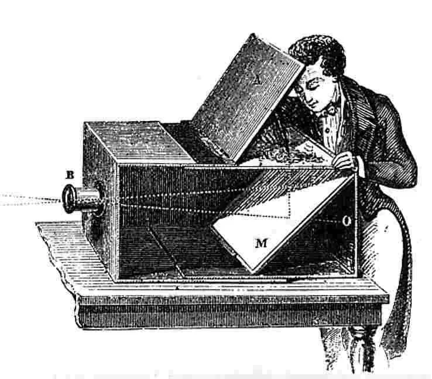
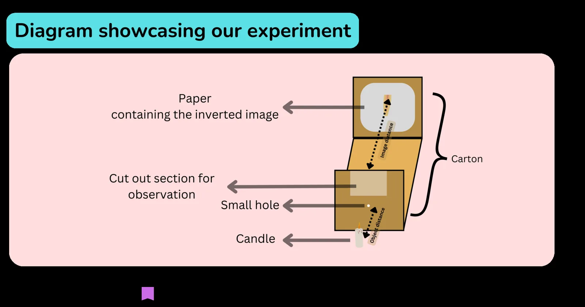
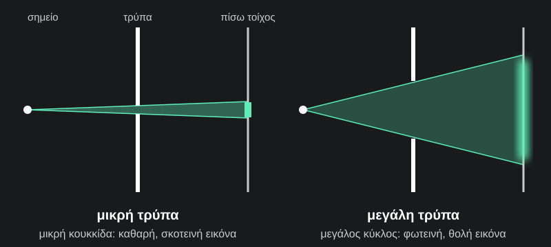
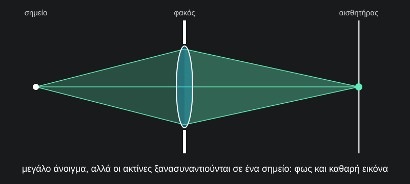
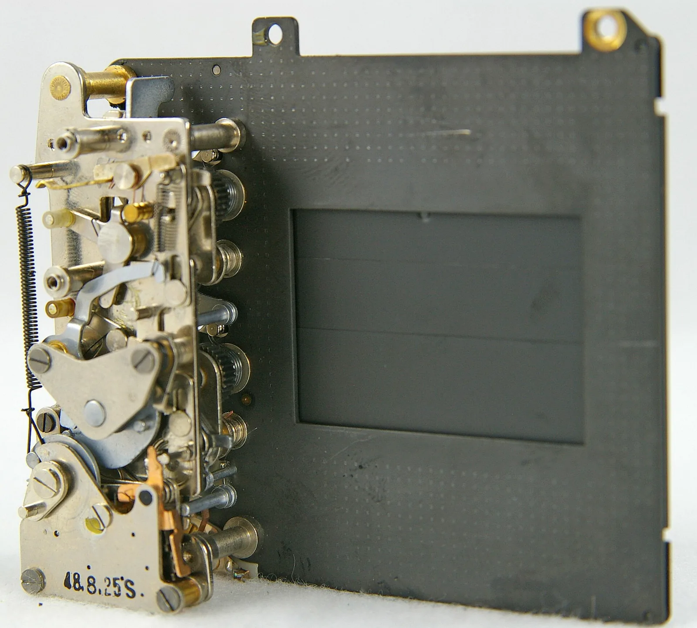
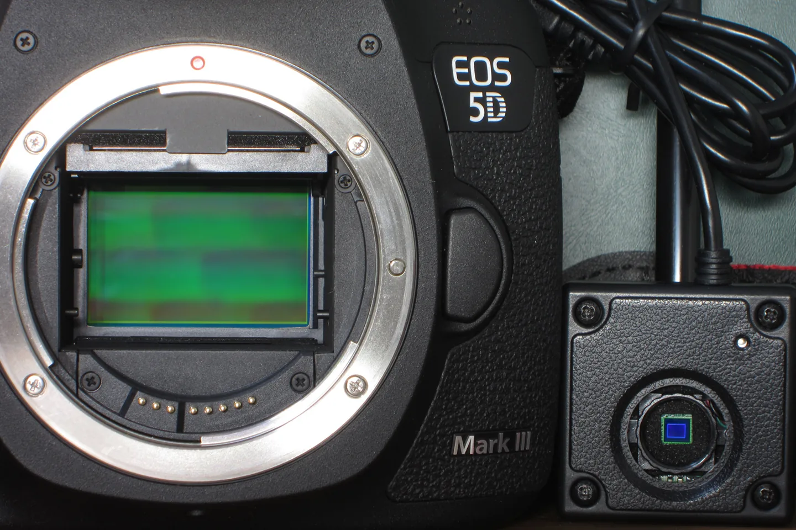
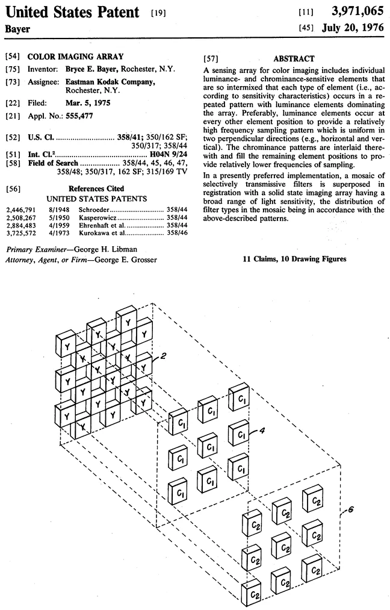
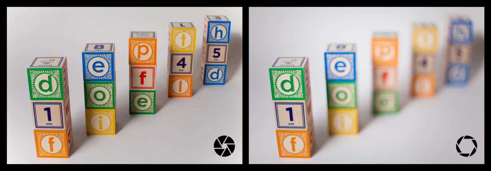
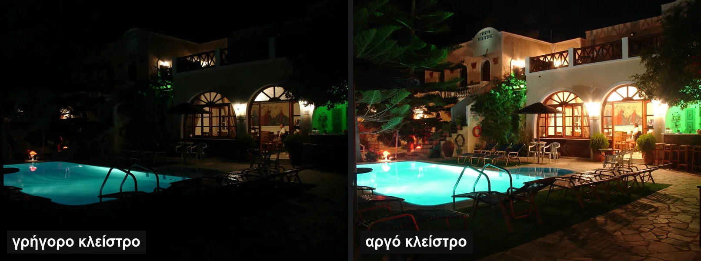
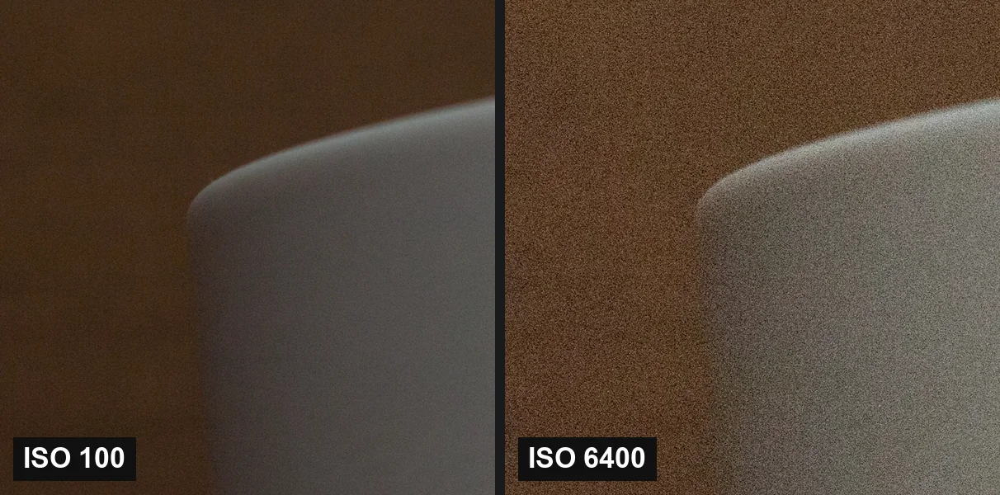

#### Camera obscura

Ένα σκοτεινό κουτί (ή δωμάτιο) με μια μικρή τρύπα. Το φως από έξω περνά από την τρύπα και σχηματίζει στον απέναντι τοίχο την εικόνα του κόσμου, ανάποδα. Αυτή είναι η ιδέα πίσω από κάθε κάμερα.

Γιατί ανάποδα; Το φως ταξιδεύει σε ευθείες: ό,τι είναι ψηλά περνά από την τρύπα και καταλήγει χαμηλά, και το αντίστροφο.

#### Μικρή ή μεγάλη τρύπα;

- **Μικρή τρύπα:** κάθε σημείο γίνεται μια μικρή κουκκίδα. Η εικόνα είναι καθαρή αλλά σκοτεινή.
- **Μεγάλη τρύπα:** μπαίνει περισσότερο φως, αλλά κάθε σημείο γίνεται ένας μεγάλος κύκλος που πέφτει πάνω στους διπλανούς. Η εικόνα είναι φωτεινή αλλά θολή.

#### Ο φακός

Ο φακός λύνει το δίλημμα: αφήνει μεγάλο άνοιγμα για να μπει πολύ φως, αλλά λυγίζει τις ακτίνες ώστε να ξανασυναντηθούν σε ένα σημείο. Έτσι έχουμε και φως και καθαρή εικόνα. **Εστίαση** (focus) σημαίνει να μετακινήσουμε τον φακό ώστε αυτά τα σημεία να πέφτουν ακριβώς πάνω στον αισθητήρα.

#### Το κλείστρο

Μια «πόρτα» μπροστά στον αισθητήρα που ανοίγει για λίγο και ξανακλείνει. Όσο είναι ανοιχτή, περνά φως.

#### Ο αισθητήρας

Το ψηφιακό αντίστοιχο του φιλμ: ένα πλέγμα από εκατομμύρια πίξελ που μετρούν πόσο φως τους έφτασε. Κάθε πίξελ έχει μπροστά του ένα μικρό κόκκινο, πράσινο ή μπλε φίλτρο, και από τον συνδυασμό τους η κάμερα φτιάχνει τα χρώματα.

#### Διάφραγμα, ταχύτητα κλείστρου, ISO

Τρεις ρυθμίσεις αποφασίζουν πόσο φωτεινή θα είναι η φωτογραφία. Η καθεμία έχει και μια «παρενέργεια»:

| Ρύθμιση | Τι αλλάζει | Για περισσότερο φως | Τι άλλο συμβαίνει |
|---|---|---|---|
| Διάφραγμα (f/) | πόσο ανοιχτός είναι ο φακός | μικρότερος αριθμός, π.χ. f/2 | θολώνει το φόντο |
| Ταχύτητα κλείστρου | πόση ώρα μένει ανοιχτό το κλείστρο | πιο αργή, π.χ. 1/30 | ό,τι κινείται θολώνει |
| ISO | πόσο ευαίσθητος είναι ο αισθητήρας | μεγαλύτερο ISO, π.χ. 3200 | εμφανίζεται θόρυβος («κόκκος») |

#### Πηγές εικόνων

Από το Wikimedia Commons. Τα δύο διαγράμματα (τρύπα, φακός) είναι δικά μας. Οι συγκρίσεις ταχύτητας κλείστρου και ISO είναι δύο εικόνες δίπλα-δίπλα με ετικέτες.

- [Camera Obscura box18thCentury](https://commons.wikimedia.org/wiki/File:Camera_Obscura_box18thCentury.jpg), κοινό κτήμα
- [Pinhole Camera Diagram](https://commons.wikimedia.org/wiki/File:Pinhole_Camera_Diagram.png) — Finitehoax, [CC0](http://creativecommons.org/publicdomain/zero/1.0/deed.en)
- [Focal-plane shutter](https://commons.wikimedia.org/wiki/File:Focal-plane_shutter.jpg) — Hustvedt, [CC BY-SA 3.0](https://creativecommons.org/licenses/by-sa/3.0)
- [CMOS Image Sensor Big and Small](https://commons.wikimedia.org/wiki/File:CMOS_Image_Sensor_Big_and_Small.jpg) — 根川孝太郎 (Kotaro Negawa), [CC BY-SA 3.0](https://creativecommons.org/licenses/by-sa/3.0)
- [US03971065 Bayer Front](https://commons.wikimedia.org/wiki/File:US03971065_Bayer_Front.png), κοινό κτήμα
- [Depth-of-field-comparison-side-by-side-small](https://commons.wikimedia.org/wiki/File:Depth-of-field-comparison-side-by-side-small.png) — MikeRun, [CC BY-SA 4.0](https://creativecommons.org/licenses/by-sa/4.0)
- [Image noise in low light sample (Canon 100D) at ISO 100 (detail)](https://commons.wikimedia.org/wiki/File:Image_noise_in_low_light_sample_(Canon_100D)_at_ISO_100_(detail).jpg) — Rodrigo.Argenton, [CC BY-SA 4.0](https://creativecommons.org/licenses/by-sa/4.0)
- [Image noise in low light sample (Canon 100D) at ISO 6400 (detail)](https://commons.wikimedia.org/wiki/File:Image_noise_in_low_light_sample_(Canon_100D)_at_ISO_6400_(detail).jpg) — Rodrigo.Argenton, [CC BY-SA 4.0](https://creativecommons.org/licenses/by-sa/4.0)
- [Shutter speed fast](https://commons.wikimedia.org/wiki/File:Shutter_speed_fast.jpg) — Stan Zurek, [CC BY-SA 3.0](http://creativecommons.org/licenses/by-sa/3.0/)
- [Shutter speed slow](https://commons.wikimedia.org/wiki/File:Shutter_speed_slow.jpg) — Stan Zurek, [CC BY-SA 3.0](http://creativecommons.org/licenses/by-sa/3.0/)
