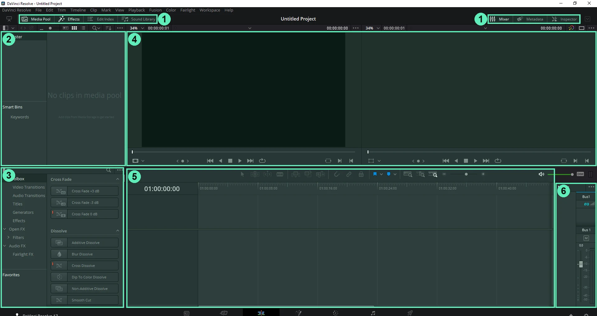

1. **Κουμπιά πάνω** – Ανοίγουν και κλείνουν τα παράθυρα: αριστερά Media Pool, Effects, Edit Index, Sound Library· δεξιά Mixer, Metadata, Inspector. Αν «χαθεί» ένα παράθυρο, το ξαναβρίσκουμε από εδώ.
2. **Media Pool** – Το υλικό του project. Από εδώ σέρνουμε τα clips στο timeline.
3. **Effects** – Μεταβάσεις, τίτλοι, generators και εφέ, έτοιμα να τα σύρουμε πάνω στα clips.
4. **Viewers** – Αριστερά βλέπουμε το clip που επιλέξαμε στο Media Pool, δεξιά το αποτέλεσμα του timeline.
5. **Timeline** – Εδώ γίνεται το μοντάζ: τα clips μπαίνουν στη σειρά, σε κανάλια βίντεο (V1, V2…) και ήχου (A1, A2…).
6. **Mixer** – Η ένταση του ήχου.
7. **Inspector** – Δεν φαίνεται στην εικόνα· ανοίγει πάνω δεξιά. Δείχνει τις ιδιότητες του clip που επιλέξαμε: μέγεθος, θέση, περιστροφή, διαφάνεια, ταχύτητα και άλλα.

#### Πηγές εικόνων

- [DaVinci resolve 17 screenshot](https://commons.wikimedia.org/wiki/File:DaVinci_resolve_17_screenshot.png) — FedericoFB, [CC BY-SA 4.0](https://creativecommons.org/licenses/by-sa/4.0), με προσθήκη αριθμών
