### Αρχές 19ου αιώνα – Γέννηση της φωτογραφίας

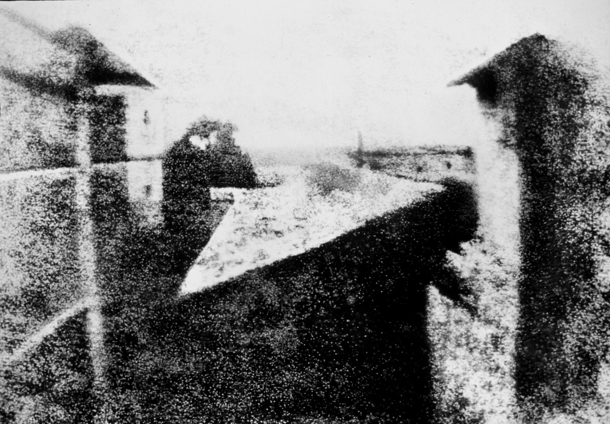

### 1895 – Η γέννηση του κινηματογράφου

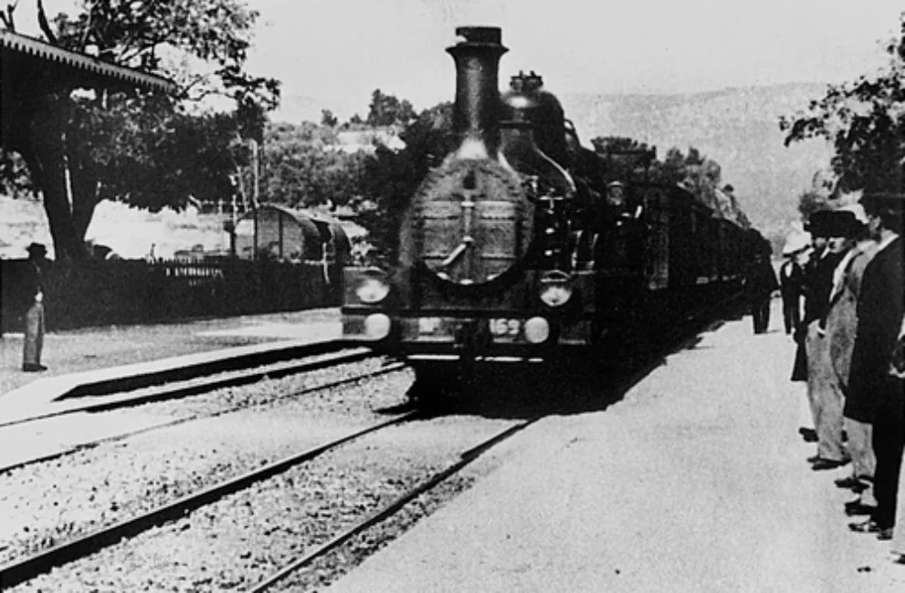

Οι αδελφοί Lumière παρουσιάζουν στο Παρίσι το Cinématographe και πραγματοποιούν την πρώτη δημόσια κινηματογραφική προβολή. Ο κινηματογράφος ξεκινά ως καταγραφή της πραγματικότητας και ως δημόσιο θέαμα.

**Χαρακτηριστικά έργα:**
- *La Sortie de l'usine Lumière à Lyon*, Auguste & Louis Lumière (1895)
- *L'Arrivée d'un train en gare de La Ciotat*, Auguste & Louis Lumière (1896)

### 1896–1910 – Ο κινηματογράφος ως αφήγηση και ο Georges Méliès

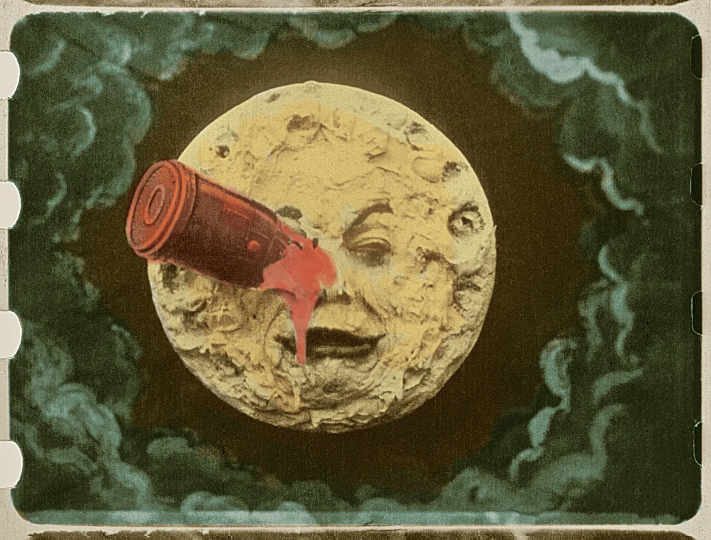

Ο κινηματογράφος περνά σταδιακά από την απλή καταγραφή στην κατασκευή φανταστικών ιστοριών. Ο Méliès αξιοποιεί το μοντάζ, τις αντικαταστάσεις πλάνων, τις πολλαπλές εκθέσεις και τα σκηνικά για να δημιουργήσει κινηματογραφικά «θαύματα».

**Χαρακτηριστικά έργα:**
- *Le Voyage dans la Lune*, Georges Méliès (1902)
- *L'Homme à la tête en caoutchouc*, Georges Méliès (1901)

### 1908–1915 – Η δημιουργία του κλασικού κινηματογραφικού μοντάζ

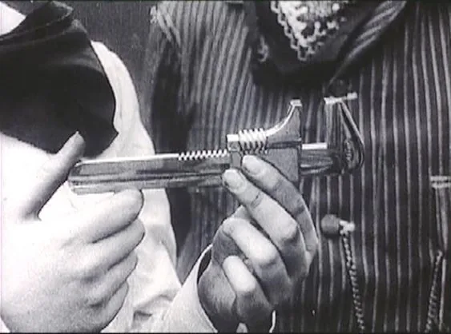

Το μοντάζ αρχίζει να οργανώνει τον χώρο και τον χρόνο μιας ιστορίας. Η παράλληλη δράση, το cross-cutting, το κοντινό πλάνο και η εναλλαγή διαφορετικών χώρων δημιουργούν μια πιο σύνθετη κινηματογραφική αφήγηση.

**Χαρακτηριστικά έργα:**
- *The Lonedale Operator*, D. W. Griffith (1911)
- *The Birth of a Nation*, D. W. Griffith (1915)

### 1920s – Γαλλικός κινηματογραφικός ιμπρεσιονισμός

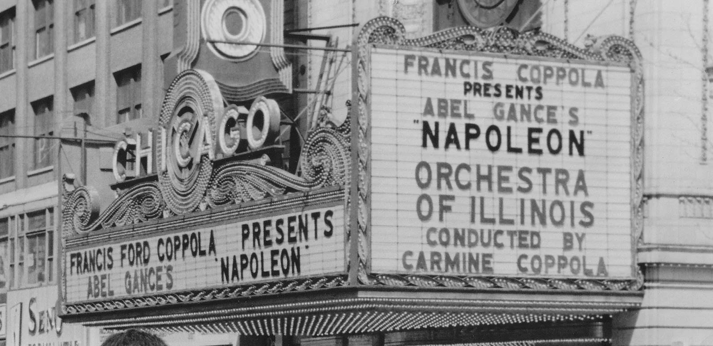

Η γαλλική πρωτοπορία χρησιμοποιεί το μοντάζ και τις κινηματογραφικές τεχνικές για να εκφράσει υποκειμενικές εμπειρίες, συναισθήματα και ψυχικές καταστάσεις αντί να περιορίζεται στην αντικειμενική αφήγηση. Χρησιμοποιούνται γρήγορες εναλλαγές, παραμορφώσεις, superimpositions και υποκειμενικά πλάνα.

**Χαρακτηριστικά έργα:**
- *La Roue*, Abel Gance (1923)
- *La Souriante Madame Beudet*, Germaine Dulac (1923)
- *Napoléon*, Abel Gance (1927)

### 1919–1933 – Γερμανικός Εξπρεσιονισμός

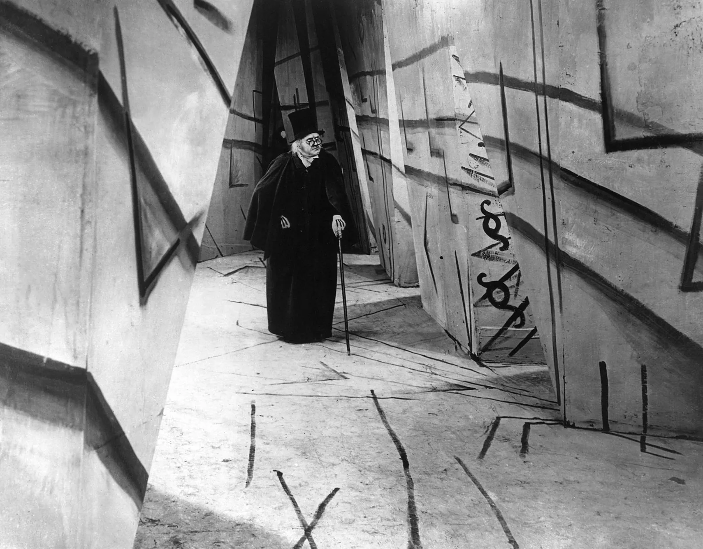

Ο γερμανικός εξπρεσιονισμός εκφράζει φόβους, αγωνίες και ψυχικές καταστάσεις μέσα από παραμορφωμένα σκηνικά, έντονες φωτοσκιάσεις και δραματικές αντιθέσεις φωτός και σκιάς. Το μοντάζ και η εικόνα δημιουργούν μια σκοτεινή, υποκειμενική και συχνά εφιαλτική ατμόσφαιρα, επηρεάζοντας τον κινηματογράφο τρόμου και το φιλμ νουάρ.

**Χαρακτηριστικά έργα:**
- *Das Cabinet des Dr. Caligari*, Robert Wiene (1920)
- *Nosferatu*, F. W. Murnau (1922)
- *Metropolis*, Fritz Lang (1927)

### 1920s – Σοβιετικό μοντάζ και η θεωρία του Kuleshov

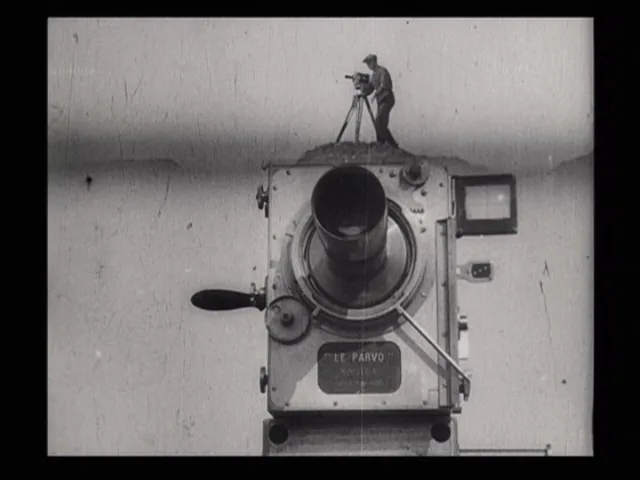

Οι σοβιετικοί κινηματογραφιστές αντιμετωπίζουν το μοντάζ ως βασικό μέσο δημιουργίας νοήματος. Ο Lev Kuleshov δείχνει ότι η σημασία ενός πλάνου επηρεάζεται από το πλάνο που το ακολουθεί, ενώ ο Eisenstein αναπτύσσει την ιδέα της «σύγκρουσης» μεταξύ εικόνων.

**Χαρακτηριστικά έργα:**
- *Strike*, Sergei Eisenstein (1925)
- *Battleship Potemkin*, Sergei Eisenstein (1925)
- *Man with a Movie Camera*, Dziga Vertov (1929)

### 1925 – Το μοντάζ ως δημιουργία ιδεών

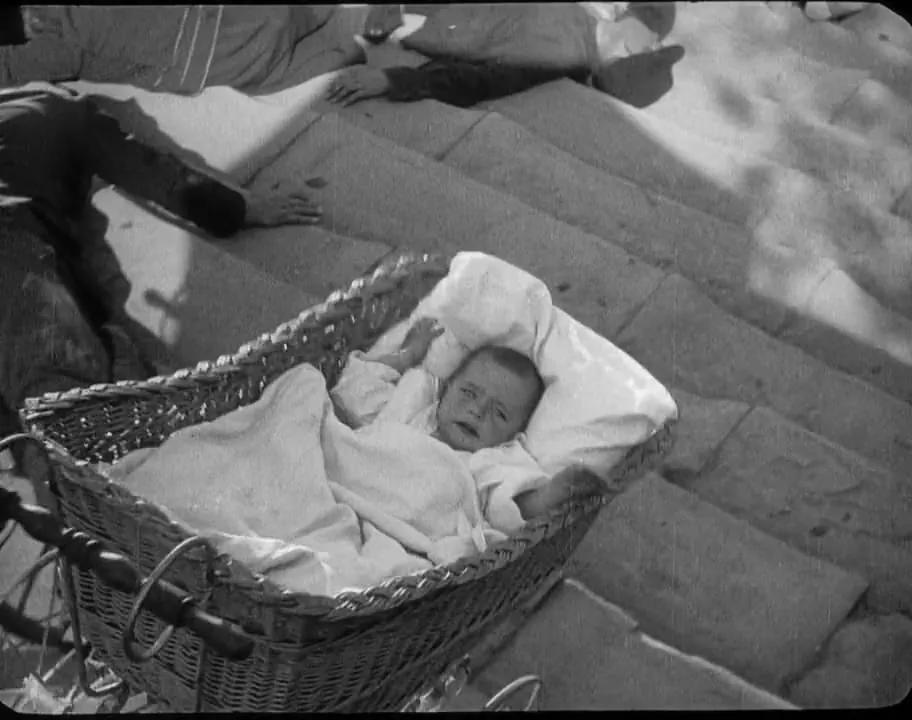

Στο Θωρηκτό Ποτέμκιν, ο Eisenstein χρησιμοποιεί τη σύγκρουση διαφορετικών πλάνων για να προκαλέσει συναισθήματα και να δημιουργήσει πολιτικό και ιδεολογικό νόημα. Η περίφημη σκηνή στις σκάλες της Οδησσού αποτελεί χαρακτηριστικό παράδειγμα μοντάζ που διασπά τον χρόνο και εντείνει την ένταση.

**Χαρακτηριστικό έργο:**
- *Battleship Potemkin*, Sergei Eisenstein (1925)

### 1927–1930 – Η μετάβαση στον ήχο

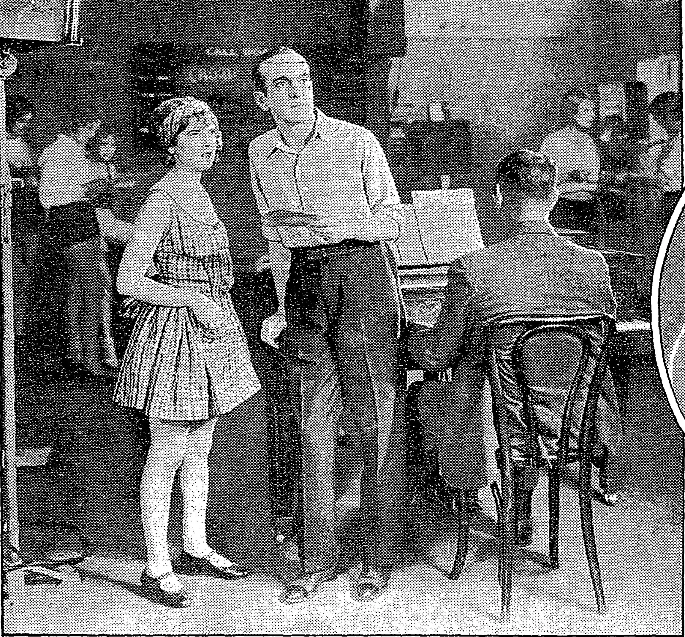

Η εμφάνιση του συγχρονισμένου ήχου αλλάζει τη γλώσσα του κινηματογράφου. Ο ήχος γίνεται πλέον μέρος του μοντάζ και μπορεί να δημιουργήσει αντιθέσεις, ρυθμό και επιπλέον πληροφορία πέρα από την εικόνα.

**Χαρακτηριστικά έργα:**
- *The Jazz Singer*, Alan Crosland (1927)

### 1940s–1950s – Ιταλικός Νεορεαλισμός

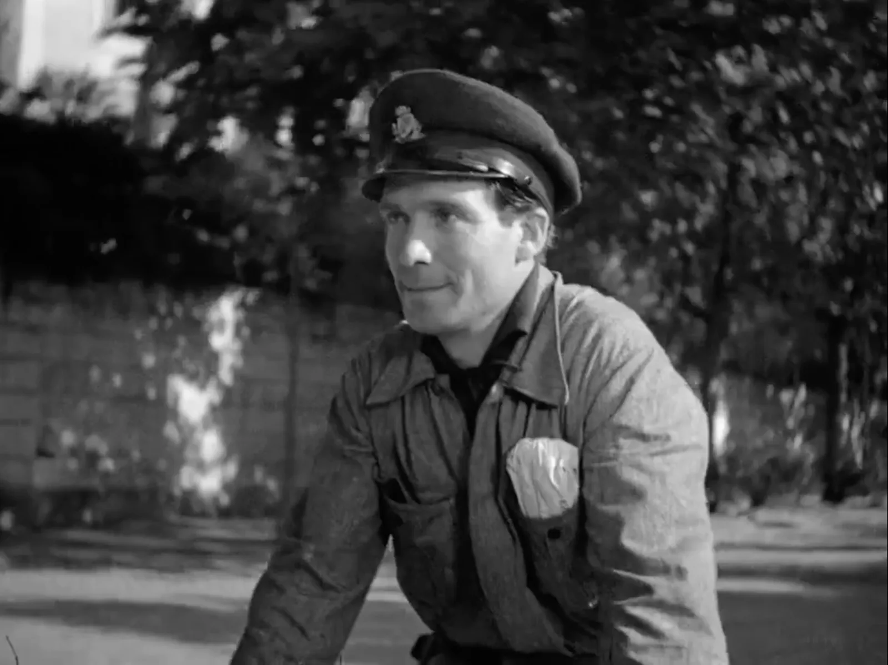

Μετά τον Β΄ Παγκόσμιο Πόλεμο, Ιταλοί σκηνοθέτες στρέφονται στην καθημερινή ζωή και στην κοινωνική πραγματικότητα, χρησιμοποιώντας πραγματικούς χώρους, φυσικό φωτισμό και συχνά μη επαγγελματίες ηθοποιούς. Το μοντάζ γίνεται λιγότερο εντυπωσιακό και υπηρετεί την αίσθηση της πραγματικότητας.

**Χαρακτηριστικά έργα:**
- *Roma città aperta*, Roberto Rossellini (1945)
- *Ladri di biciclette*, Vittorio De Sica (1948)
- *Umberto D.*, Vittorio De Sica (1952)

### 1950s–1960s – French New Wave

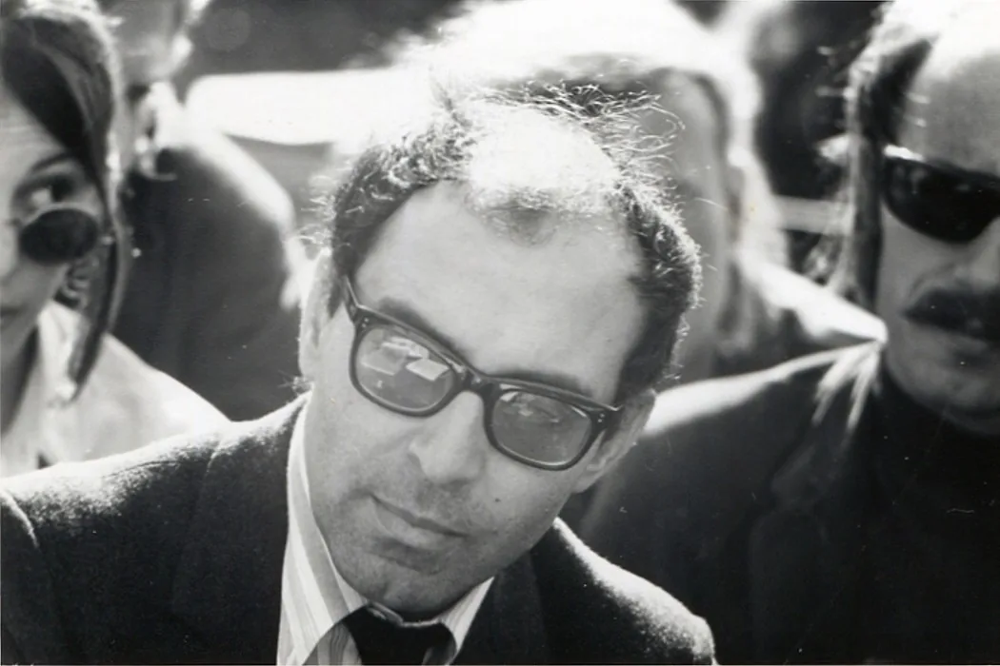

Νέοι Γάλλοι σκηνοθέτες αμφισβητούν τους κανόνες του κλασικού κινηματογράφου και κάνουν το μοντάζ εμφανές στον θεατή. Χρησιμοποιούν jump cuts, ασυνέχειες, φορητή κάμερα και πιο ελεύθερη αφήγηση, επηρεασμένοι από την κινηματογραφική θεωρία και την αμερικανική και ευρωπαϊκή παράδοση.

**Χαρακτηριστικά έργα:**
- *Les Quatre Cents Coups*, François Truffaut (1959)
- *À bout de souffle*, Jean-Luc Godard (1960)
- *Cléo de 5 à 7*, Agnès Varda (1962)

### 1960s – Video Art και η εικόνα ως καλλιτεχνικό μέσο

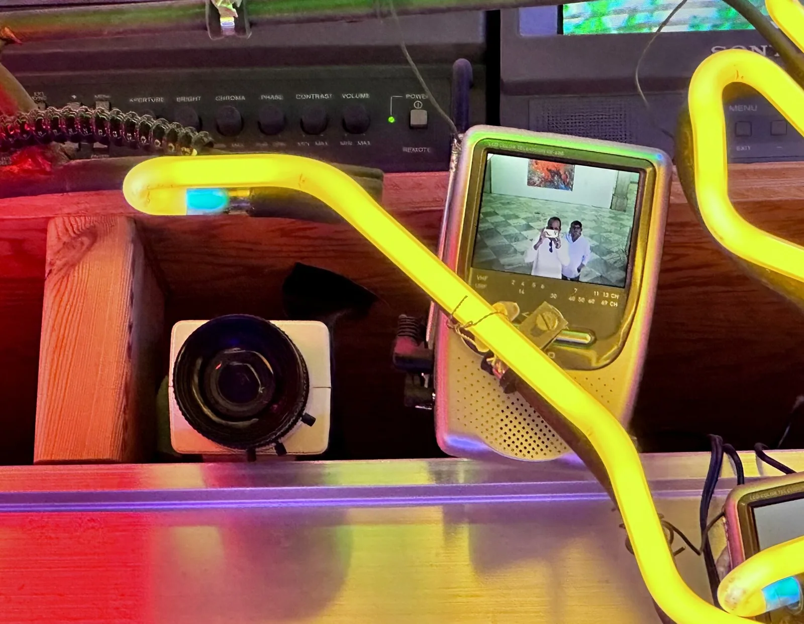

Η εμφάνιση φορητών βιντεοκαμερών επιτρέπει στους καλλιτέχνες να χρησιμοποιούν το βίντεο έξω από το παραδοσιακό πλαίσιο του κινηματογράφου και της τηλεόρασης. Η εικόνα γίνεται αντικείμενο πειραματισμού, εγκατάστασης και performance.

**Χαρακτηριστικά έργα:**
- *Magnet TV*, Nam June Paik (1965)
- *TV Buddha*, Nam June Paik (1974)
- *Electronic Superhighway*, Nam June Paik (1995)

### 1960s–1970s – Νέο Hollywood και ελεύθερο μοντάζ

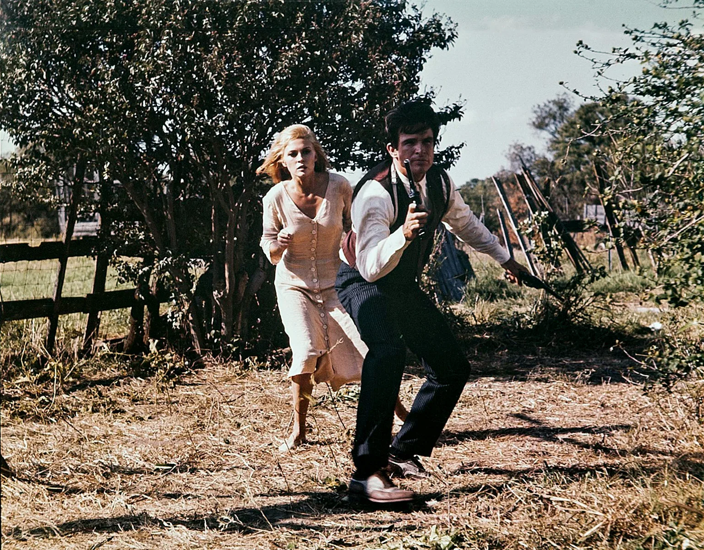

Η επιρροή της ευρωπαϊκής πρωτοπορίας και της French New Wave περνά στον αμερικανικό κινηματογράφο. Οι σκηνοθέτες χρησιμοποιούν jump cuts, μη γραμμική αφήγηση, διαφορετικούς ρυθμούς και πιο εμφανές μοντάζ.

**Χαρακτηριστικά έργα:**
- *Bonnie and Clyde*, Arthur Penn (1967)
- *Easy Rider*, Dennis Hopper (1969)
- *The Godfather*, Francis Ford Coppola (1972)

### 1995 – Dogme 95

Οι Lars von Trier και Thomas Vinterberg δημιουργούν το Dogme 95, ένα μανιφέστο που περιορίζει τεχνητά μέσα, ειδικά εφέ, τεχνητό φωτισμό και άλλες κινηματογραφικές παρεμβάσεις. Η κάμερα και το μοντάζ πρέπει να υπηρετούν την αυθεντικότητα της δράσης.

**Χαρακτηριστικά έργα:**
- *Festen*, Thomas Vinterberg (1998)
- *The Idiots*, Lars von Trier (1998)

### 1990s–2000s – Η ψηφιακή επανάσταση στο μοντάζ

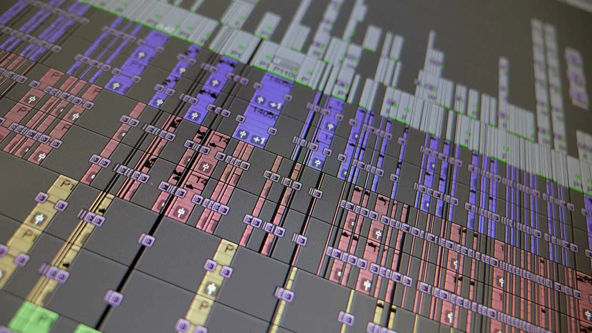

Η μετάβαση από το φιλμ στο ψηφιακό μοντάζ κάνει τη διαδικασία μη γραμμική, ταχύτερη και πιο ευέλικτη. Προγράμματα όπως το Avid, το Final Cut Pro και αργότερα το Premiere και το DaVinci Resolve αλλάζουν ριζικά τον τρόπο με τον οποίο μοντάρεται μια ταινία.

**Χαρακτηριστικά έργα:**
- *The English Patient*, Anthony Minghella (1996)
- *The Matrix*, Lana & Lilly Wachowski (1999)

### 2000s–σήμερα – Το μοντάζ χωρίς όρια

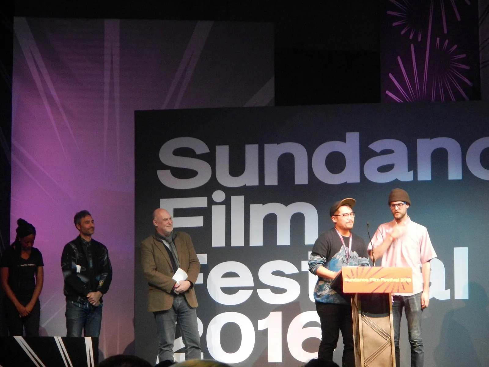

Η ψηφιακή τεχνολογία, τα VFX, τα computer-generated images και οι νέες πλατφόρμες διευρύνουν δραματικά τις δυνατότητες του μοντάζ. Η μη γραμμική αφήγηση, οι πολλαπλές χρονικότητες και η συνεχής επεξεργασία εικόνας γίνονται βασικά εργαλεία του σύγχρονου κινηματογράφου και της οπτικοακουστικής τέχνης.

**Χαρακτηριστικά έργα:**
- *Memento*, Christopher Nolan (2000)
- *Eternal Sunshine of the Spotless Mind*, Michel Gondry (2004)
- *Everything Everywhere All at Once*, Daniel Kwan & Daniel Scheinert (2022)

### Πηγές εικόνων

Όλες οι εικόνες από το Wikimedia Commons.

- [View from the Window at Le Gras, Joseph Nicéphore Niépce](https://commons.wikimedia.org/wiki/File:View_from_the_Window_at_Le_Gras,_Joseph_Nic%C3%A9phore_Ni%C3%A9pce.jpg), κοινό κτήμα
- [Arrivée d’un train à La Ciotat 1897](https://commons.wikimedia.org/wiki/File:Arriv%C3%A9e_d%E2%80%99un_train_%C3%A0_La_Ciotat_1897.png), κοινό κτήμα
- [Melies color Voyage dans la lune](https://commons.wikimedia.org/wiki/File:Melies_color_Voyage_dans_la_lune.jpg), κοινό κτήμα
- [Lonedale2 099](https://commons.wikimedia.org/wiki/File:Lonedale2_099.jpg), κοινό κτήμα
- [Napoleon (1927) shown in Chicago in 1981 (1)](https://commons.wikimedia.org/wiki/File:Napoleon_(1927)_shown_in_Chicago_in_1981_(1).jpg) — Alan Light, [CC BY 2.0](https://creativecommons.org/licenses/by/2.0)
- [Publicity still for The Cabinet of Dr. Caligari (1920) 03](https://commons.wikimedia.org/wiki/File:Publicity_still_for_The_Cabinet_of_Dr._Caligari_(1920)_03.jpg), κοινό κτήμα
- [Man with a Movie Camera by Dziga Vertov](https://commons.wikimedia.org/wiki/File:Man_with_a_Movie_Camera_by_Dziga_Vertov.jpg), κοινό κτήμα
- [Odessastepsbaby](https://commons.wikimedia.org/wiki/File:Odessastepsbaby.jpg), κοινό κτήμα
- [May McAvoy and Al Jolson in The Jazz Singer](https://commons.wikimedia.org/wiki/File:May_McAvoy_and_Al_Jolson_in_The_Jazz_Singer.jpg), κοινό κτήμα
- [Ladri di biciclette (1948) Lamberto Maggiorani](https://commons.wikimedia.org/wiki/File:Ladri_di_biciclette_(1948)_Lamberto_Maggiorani.png), κοινό κτήμα
- [Jean-Luc Godard at Berkeley, 1968 (1)](https://commons.wikimedia.org/wiki/File:Jean-Luc_Godard_at_Berkeley,_1968_(1).jpg) — Gary Stevens, [CC BY 2.0](https://creativecommons.org/licenses/by/2.0)
- [Electronic Superhighway Continental U.S., Alaska, Hawaii - closed-circuit camera](https://commons.wikimedia.org/wiki/File:Electronic_Superhighway_Continental_U.S.,_Alaska,_Hawaii_-_closed-circuit_camera.jpg) — APK, [CC BY 4.0](https://creativecommons.org/licenses/by/4.0)
- [Bonnie and Clyde (1967 promo photo - Dunaway & Beatty)](https://commons.wikimedia.org/wiki/File:Bonnie_and_Clyde_(1967_promo_photo_-_Dunaway_%26_Beatty).jpg), κοινό κτήμα
- [Lars von Trier 2014](https://commons.wikimedia.org/wiki/File:Lars_von_Trier_2014.jpg) — Siebbi, [CC BY 3.0](https://creativecommons.org/licenses/by/3.0)
- [AVID MEDIA COMPOSER CHILEVISION](https://commons.wikimedia.org/wiki/File:AVID_MEDIA_COMPOSER_CHILEVISION.jpg) — Cristobal Frigerio, [CC0](http://creativecommons.org/publicdomain/zero/1.0/deed.en)
- [Daniel Scheinert and Daniel Kwan (24944240722)](https://commons.wikimedia.org/wiki/File:Daniel_Scheinert_and_Daniel_Kwan_(24944240722).jpg) — PunkToad from oakland, us, [CC BY 2.0](https://creativecommons.org/licenses/by/2.0)
