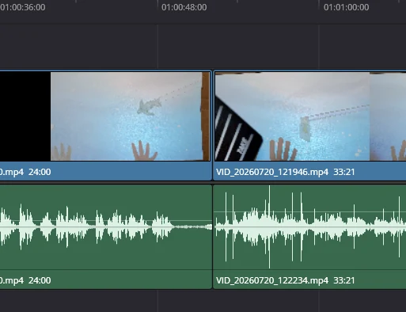
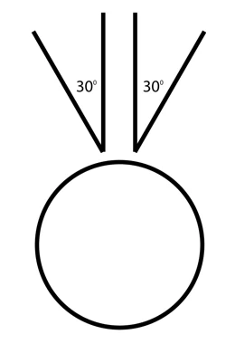
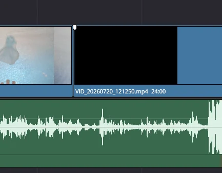

**Τι θα δούμε:**
1. Διαφορετικούς τύπους **μεταβάσεων**
2. Πώς χρησιμοποιούνται
3. Παραδείγματα

### 1. Το Cut

Η πιο συνήθης και απλή μορφή μετάβασης, όπου ένα πλάνο

- **διακόπτεται απότομα**
- και **αντικαθίσταται αμέσως** από το επόμενο.

Παρακάτω θα δούμε συχνούς τύπους cut.

#### Straight / Hard Cut

Απλή μετάβαση. Αλλάζει η γωνία λήψης ή η σκηνή.

https://www.youtube.com/watch?v=H64fMsrrFoo

#### Σκηνή;

Η σκηνή είναι η βασική **μονάδα** της αφήγησης στο σινεμά.

Είναι μία ή περισσότερες λήψεις που συνδέονται νοηματικά, συνήθως με έναν από τους παρακάτω τρόπους:

- Κοινός **χρόνος**
- Κοινός **τόπος**
- Μία κοινή **ιδέα** (π.χ. μία σκηνή όπου δύο φίλοι μαλώνουν διακόπτεται από μια σκηνή όπου ο ένας στραβοκαταπίνει και πνίγεται)

#### Hidden Cut

Πρόκειται για δύο πλάνα που έχουν ένα κοινό καρέ, **ώστε να μην καταλαβαίνει ο/η θεατής την αλλαγή.**

https://www.youtube.com/watch?v=FmCMYY6UWCA

https://www.youtube.com/watch?v=KYfiblQccHo

#### Match Cut

Η μετάβαση από ένα πλάνο σε ένα άλλο, όπου η **σύνθεση έχει ομοιότητες.**

https://www.youtube.com/watch?v=-P8zSTvTWHQ

https://www.youtube.com/watch?v=AlGy1SxhLRA

#### Contrast Cut

Η μετάβαση από ένα πλάνο σε ένα άλλο, όπου η **σύνθεση φέρει διαφορές.**

#### Jump Cut

Η γωνία λήψης είναι η ίδια ή κοντινή, και γίνεται **εμφανές** πως κάτι χάθηκε στο ενδιάμεσο.

https://www.youtube.com/watch?v=R6eRtIm4ykw

https://www.youtube.com/watch?v=jVWbkM4r3cg

#### Κανόνας των 30°

Όταν σε μία σκηνή αλλάζει η γωνία λήψης, πρέπει να αλλάζει **πάνω από 30 μοίρες.**

Αλλιώς φαίνεται σαν jump cut και δίνει την αίσθηση του λάθους.

#### Κανόνας των 180°

Όταν σε μία σκηνή αλλάζει η γωνία λήψης, πρέπει να αλλάζει **κάτω από 180 μοίρες.**

Αλλιώς ο θεατής μπερδεύεται: «πού βρίσκομαι τώρα;»

#### L-cut

Ο ήχος του πρώτου πλάνου συνεχίζει να ακούγεται και πάνω στην εικόνα του επόμενου.

https://www.youtube.com/watch?v=WdO5SoxTZa0

#### J-cut

Ο ήχος του επόμενου πλάνου ξεκινά πριν εμφανιστεί η εικόνα του.

https://www.youtube.com/watch?v=VqmEwEfOVE0

#### Cut-in

**Παρεμβολή ενός κοντινού πλάνου.** Χρησιμοποιείται συνήθως για να δώσει περισσότερη πληροφορία.

https://www.youtube.com/watch?v=RqegjymWT4I

#### Cutaway

**Παρεμβολή ενός πλάνου που δεν είναι μέρος της σκηνής.** Χρησιμοποιείται συνήθως για να συμπτύξει τον χρόνο.

https://www.youtube.com/watch?v=XY2rZ_XSLTQ

### 2. Το Fade

#### Fade-in

**Εμφάνιση ενός πλάνου σταδιακά από το μαύρο.**

#### Fade-out

**Σταδιακή εξαφάνιση ενός πλάνου προς το μαύρο.**

Όταν εξαφανίζεται προς το άσπρο, λέγεται Wash-out.

#### Cross Dissolve

**Αργή μετάβαση από ένα πλάνο σε ένα άλλο.**

https://commons.wikimedia.org/wiki/File:The_Stranger_(1946)_dissolve.webm

### 3. Το Wipe

#### Wipe

Η εναλλαγή των πλάνων γίνεται μέσω της **μετακίνησης του πρώτου πλάνου προς το πλάι.** Το δεύτερο πλάνο εμφανίζεται στον κενό χώρο.

https://www.youtube.com/watch?v=SJ1CcaawxmA

#### Iris Wipe

**Παλιό εφέ κλεισίματος που γινόταν αρχικά οπτικά, χρησιμοποιείται πλέον κυρίως για υπερβολή.**

https://www.youtube.com/watch?v=6IkWmvYTctg
